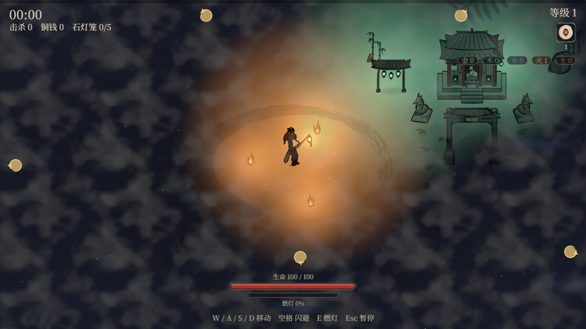
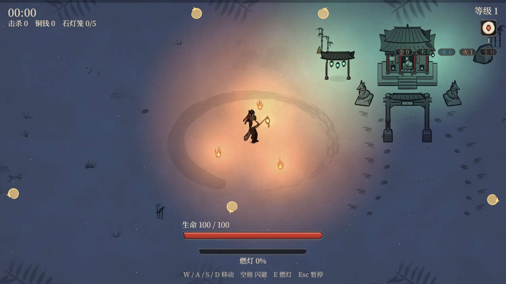
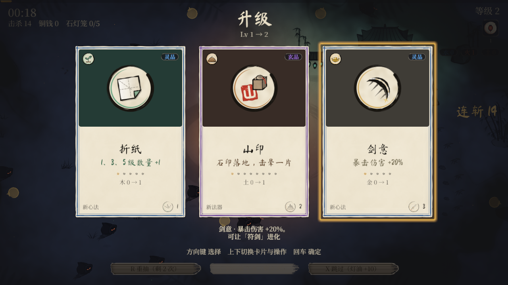
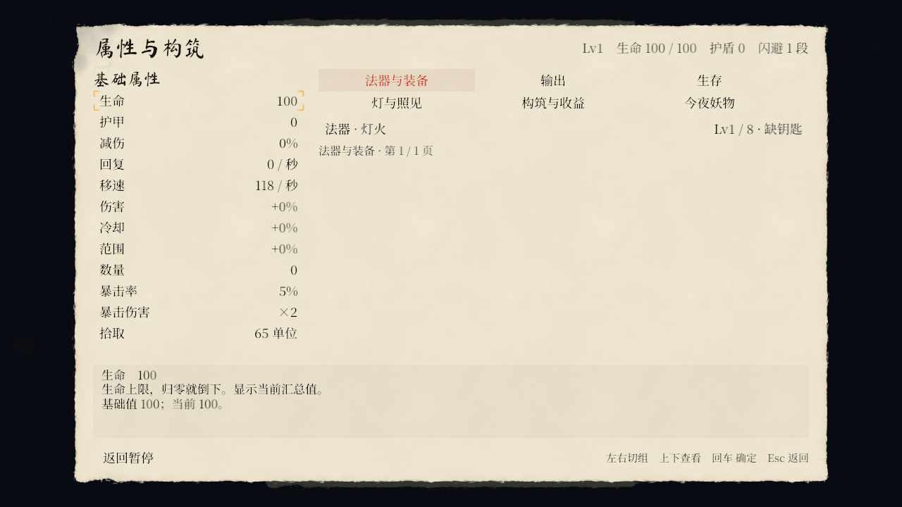
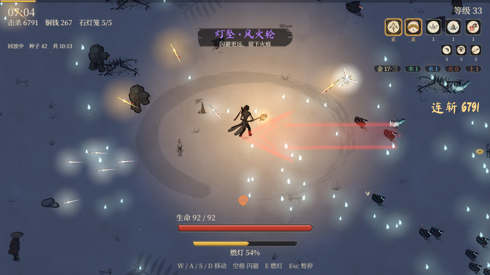

# 试玩反馈与修正进度

由美术会话维护（第 1 轮起由用户指定统筹）。各会话把进度发消息给美术会话，由美术会话更新这份文档。

## develop 协作打磨（2026-10-16）

本轮由总协调管理 `develop`，七路实现与追加的两路审查见 [TEAM.md](TEAM.md)。原 `feat/manual-god-mode` 工作区和远端 `master` 均未改动；下方历史反馈保留。

- **画面**：普通月夜移除常驻雾、提高环境底光；无月保留原夜色，浓雾夜签保留雾。天明从当局实际底光连续过渡。
- **界面**：升级卡改为图像、卡名、一行收益和等级点，完整说明随焦点显示；目前使用已有图标，新插画仍需独立美术制作。生命、护盾、燃灯扩大并区分层级，打开选择/暂停/结算时收起底部状态条以免遮挡说明；窄窗按同一列数计算画布与卡片网格。
- **动作与反馈**：闪避朝向跟随实际速度，动作覆盖真实闪避时长；竹魅只有真实出手才播释放动作，按带代数的个体句柄区分。铜钱剑有铜金扇扫、钱鸣，天罡环斩与实际再斩痕迹；竹刺有稳定危险走廊与独立弹体。
- **玩法内容**：铜钱剑加入卡池，满级配锐目进化天罡；狐火、竹魅、讨封狐按既有青丘规格出场。远程攻击保留完整预警，出生、现形、控制与击退边界已处理。
- **追加审查**：修复讨封狐伪装被误作完全隐身；回放状态避开夜主名称，近身预警边界高于长弹道。护盾数值使用一致取整。
- **查询**：暂停 → 属性与构筑，可查看基础/进阶属性、当前装备和进化缺口；支持键鼠与方向导航、分组和翻页。数值读取真实模拟；本轮没有新增 Tab 快看或来源逐项拆账。

### 实机记录

以下是本轮本机 Vulkan GPU、1280×720 的真实画面。前后均为种子 42 的开局；帧时刻、灯焰位置略有不同。使用隔离的调试存档，不计正式奖励。属性页也在实机确认了分组、输出第二页、返回行为。

| 改动前 | 本轮月夜与 HUD |
| --- | --- |
|  |  |

已用现有工具录制一局剑修调试回放，并实机查看中段、夜主阶段与天明结算；这不是胜率或平衡结论。尚未把“顶级 AAA 质感”视为达成：角色/妖物材质与场景丰富度、专属卡画、武器逐帧特效仍有明显提升空间；无月/浓雾的全部动态组合也未逐一实机复核。

验证完成：`cargo fmt --all --check`、工作区 `clippy --all-targets --locked -- -D warnings`、`cargo test --workspace --locked` 均通过（427 项通过、2 项沿用既有 ignored）。字体覆盖全部 1090 字，Rust/Python 色板与参考图一致。既有黄金文件按新增内容/瞄准状态更新；夜主独立场景的招式事件轨迹保持原样。

## 第 1 轮（2026-10-16）

### 用户原话

> 武器太少，多样性太少，玩家感觉不好玩；地图感觉有一层雾一样看不清；怪的种类太单一了，形象太差了；怪物的攻击判定感觉有问题，有时候明明感觉打不到我，还是掉血了；文字太多了，全是字，玩家是玩游戏的，不是看书的；特效感觉不够惊艳。
>
> 还有图片很劣质，需要一种高质感——我说的升级卡片。升级选择不应该做一些图吗？只有卡片文字太劣质了。
>
> 还有主角的状态栏，现在的状态栏太小了，质感也比较差。
>
> 法器升满级之后搭配心法可以进化法器是吗？刚开始的时候池子是不是应该少一点？更高阶的后面会依次解锁？我玩了一局感觉法器进化比较难，可能是池子太乱了？
>
> 还有一个缺点：对局内看不到角色的属性。包括基础的属性、进阶的属性都没有，应该补充上，鼠标悬停可以看属性的含义等。

### 用户定的取舍

- **夜色**：整体调亮，像月夜，暗处也能看清地面和妖物。“无月”夜签保留现在的黑夜。
- **妖物**：问题主要是“不好看”（造型粗糙、像低模），全部重做。
- **升级**：次数不变，卡片改成以图为主。
- **卡片**：要有高级感，每张卡都有插画。
- **样张**：出来先发给用户看，用户选定之前不批量画、不推送。

### 分工与进度

| # | 问题 | 做法要点 | 负责 | 状态 |
|---|---|---|---|---|
| 1 | 攻击判定 | 接触伤害按画出来的身体算（`contact_radius`）；冻住、眩晕的妖不造成接触伤害；冲锋预警线和真实危险区一致；刚刷出的妖 0.4 秒内不伤人；狐火弹幕画在腰部高度；血祭坛要按键确认 | 架构；玩法复测 | 已推送 0b1e512（合并 704420e），7 条都做了，测试在 `crates/sim/tests/contact.rs`；等玩法 `kite` 复测 |
| 2 | 雾 → 月夜 | 平时关掉全屏薄雾和冷蓝雾团；夜色基调提到月光蓝；灯光中间平、边缘收得快；纸面加层次 | 质感牵头；美术出贴图 | 质感在改；美术贴图候选在做（灯光 r ≤ 0.4 平、往外余弦收；纸纹亮度标准差 0.035–0.045，均值不变） |
| 3 | 升级卡片 | 上半张大插画，下面是卡名、一行数值、等级点；稀有度靠卡框材质和光区分；说明和背景故事移进图鉴 | 美术出图；架构改版式；世界观写短句 | 美术样张在做，用户先看；架构在搭卡片骨架（300×460，插画先用放大的图标，帧名 `ui/card_<id>`，卡框 `card_frame_<稀有度>`）；插画题材 5e559a7（LORE-TEXT 第 7 节） |
| 4 | 文字太多 | 按键提示前两局后隐藏；各种说明只讲一次；提示条 ≤ 8 字；HUD 改图标；设置里加伤害数字开关 | 世界观、架构 | 界面少字 3f550e8、短句接入 c76f89b（`short` 字段）、世界观收尾 737b19d；补给卡等卡片版式；HUD 的五行计数和夜签改图标，跟第 8 项状态栏样张一起定 |
| 5 | 特效 | 第一轮：闪光提到暗层之上、震屏下限、轻顿帧、辉光、用上闲置的图、进化演出；第二轮：逐帧特效图 | 质感牵头；美术出图；架构配合 | 质感第一轮排在月夜之后 |
| 6 | 武器 | 异化与合璧默认打开；新增铜钱剑、青藤、沧浪、孔明灯、镇妖塔，每个五行两件 | 玩法（规格、模拟）；架构（合并、画面）；美术；质感；世界观 | 异化与合璧已默认打开 9014900（合并 a4903b4，百鸟朝凤护身改以主角为圆心、赤霄冷却 0.42 穿透 5）；新法器规格 31d4729（BALANCE 6.3）；玩法在 master 上跑全套 kite |
| 7 | 妖物 | 狐火、竹魅、讨封狐进游戏；全部妖物按选定画法重做，疾影换成独立造型 | 玩法（行为）；美术（重做）；世界观（外形描述）；架构（画面） | 外形描述已交；美术样张在做，用户先看；三只妖物的模拟在架构的判定改动之后做 |
| 8 | 状态栏 | 头像圆章与等级印；血条约 460×30，数字在条里，护盾叠加，受伤留残影；燃灯充能做成灯笼刻度；经验条加粗；法器格约 64、心法格约 44；和卡面用同一套材质 | 美术出样张；架构改 `hud.rs`；质感加动效 | 样张排在卡面样张之后，用户一次选定整套界面风格 |
| 9 | 进化太难、卡池太乱 | 开局卡池小、局内依次放出更多心法，新法器走局外进度解锁；新心法、新法器按类别给总权重，不随内容变多而稀释；持有法器时它的进化心法更容易出现；卡面和属性面板画出配对心法 | 玩法设计并用机器人量（第一次进化时间、6 分钟前至少进化一件的比例）；架构改卡池代码 | 玩法在设计，方案先给用户确认 |
| 10 | 局内看不到属性 | 暂停界面加属性面板（按住 Tab 也能看）：基础属性约 12 项一直显示；进阶属性按组列（输出、生存、照见与灯、构筑与收益、本夜的妖物），默认只列和基础值不同的，可切到全部；鼠标悬停或焦点移到上面时显示一句含义，最好再列来源；法器一栏写等级和进化还差哪门心法 | 架构做界面；世界观写 72 项属性的标签和含义；美术出 `ui/stat_*` 与组图标 | 文字 3d3ed9b（LORE-TEXT 第 8 节：72 项标签与悬停说明，分 6 组）；界面排在卡片骨架之后 |

### 这一轮临时放宽的分工

- **玩法会话**：可以写 `crates/sim` 和 `assets/data` 里法器、妖物的代码和数据，走分支和 PR，由架构会话合并。
- **世界观会话**：可以直接改 `assets/data/*.ron` 里的 `name`、`desc`、`flavor`。
- **质感会话**：可以改 `crates/view/src/{lighting,fx,impact,effects}.rs` 里和观感有关的常量与画法，推送前告诉架构会话。

### 发布

- **v0.2.0 快修版**：
  - 第 1、2、4 项；
  - 第 5 项第一轮；
  - 打开异化与合璧；
  - 三只现成妖物进游戏；
  - 卡片换新版式，插画先用现有图标放大。
- **v0.3.0 内容版**：新卡面插画、重做的妖物、5 件新法器、逐帧特效图。

### 验收

- **攻击判定**：每条改动都有模拟测试；`kite` 胜率回到 `docs/BALANCE.md` 的目标区间。
- **月夜、特效、卡片、妖物**：先出同一份回放、同一秒的前后截图或样张，用户看过再定。
- **最终**：用户试玩 v0.2.0，对照上面 10 项逐条确认，没解决的转入下一轮。

### 接触半径（美术从图上量的）

做法：

- 取朝东的帧（游戏里会翻转成面向主角），量锚点往上 52 单位（主角身高）以内、每一行身体最靠前的那个点；
- 取每一行前沿距离的第 90 百分位，再在动画各帧之间取中位数；
- 换算成世界单位，结果和碰撞半径 `radius` 取较小的那个。

| 妖物 | radius | 画出来的前沿 | 建议 contact_radius |
|---|---|---|---|
| 影妖 shade | 13 | 14.0 | 13 |
| 疾影 wisp | 10 | 5.6 | 6 |
| 石妖 golem | 19 | 18.1 | 18 |
| 赤面狐 fox | 24 | 走 22.5 / 扑 27.7 | 22（扑击时 24） |
| 青面鬼 ghoul | 30 | 走 21.5 / 冲 30.1 | 21（冲锋时 30） |
| 石将 stonelord | 28 | 14.0 | 14 |
| 九尾 jiuwei | 44 | 走 41.8 / 扫 33.9 / 召 39.8 | 40 |
| 金蟾 toad | 14 | 16.4 | 14（不伤人） |
| 狐火 fox_wisp | 10 | 13.8 | 10 |
| 竹魅 bamboo_wraith | 12 | 走 19.1 / 射 24.5 | 12 |
| 讨封狐 taofeng_fox | 13 | 11.0 | 11 |

妖物重做之后，新图集会在 `meta.lantern.assets` 里带上 `contact_radius`，到时以图集为准更新。
