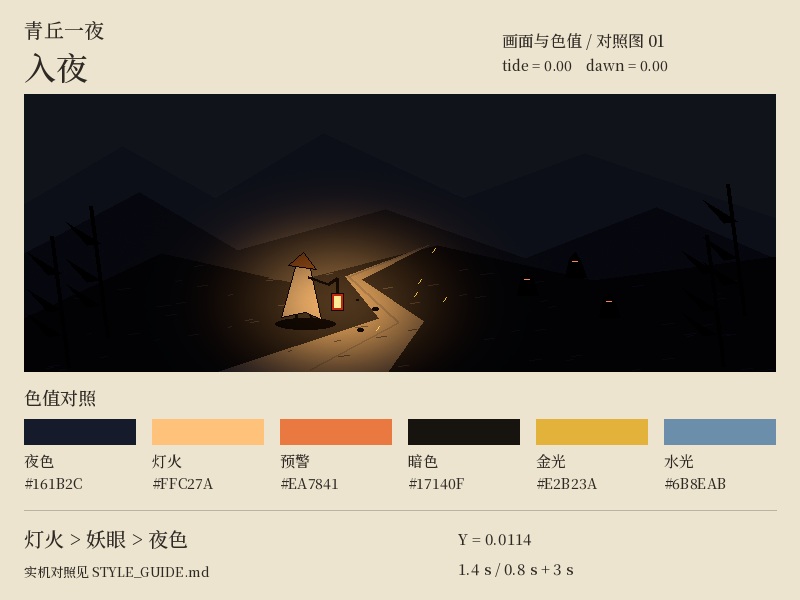
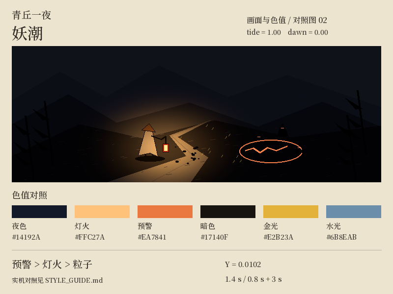
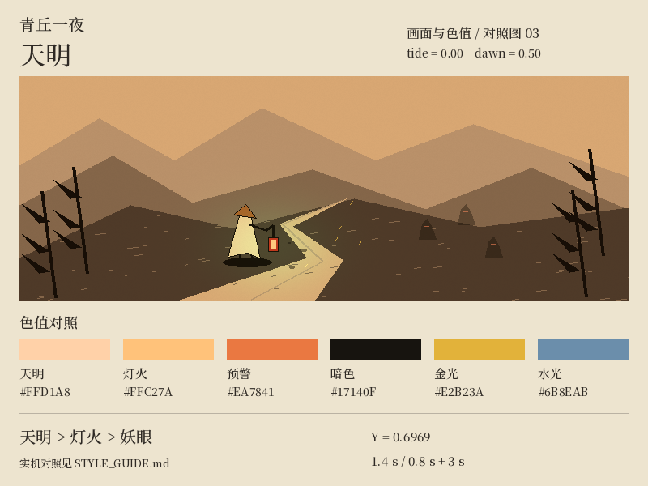

# 青丘一夜 · 视觉样板（M1-7）

这组三张标准参考用于对照「入夜 → 妖潮 → 天明」的墨色、粒子色与亮度主次。它们是 **800 × 600 的程序生成色板与构图示意，不是实机截图**。同机位、同轮廓、同种子，采用纸面乘线性光照、小面积自发光相加；没有模拟图集细节、HDR 辉光、真实遮挡、屏幕色彩管理。山路与角色只是面积标记，不是新增游戏资产。

## 三张标准参考

| 入夜 | 妖潮 | 天明中段 |
| --- | --- | --- |
|  |  |  |

原图：[入夜](style_frames/01_night.png)、[妖潮](style_frames/02_tide.png)、[天明](style_frames/03_dawn.png)。完整参数：[parameters.json](style_frames/parameters.json)。天明图取 `Dawn::progress() = 0.5`，即倒下后累计 **2.3 秒演出时间**；终点鱼肚白在下表中定义。

## 色板同源

美术来源为 [`art/style/style.py`](../art/style/style.py) 的 `RUNTIME_COLORS` 和 `RUNTIME_LEVELS`；运行时集中在 [`palette.rs`](../crates/view/src/palette.rs)，粒子、氛围、光源与裂隙引用它。生成脚本逐项比对两边常量，不一致即失败。修改时同步两处，再重生参考图。基础素材色板、图集与内容数据未改，不需重渲整套图集。

| 用途 / Rust 常量 | sRGB | 来源或换算 |
| --- | --- | --- |
| 墨线、墨滴、灰、化墨 / `INK` | `#17140F` | 精确对齐 `INK["jiao"]`；替换粒子原来的偏冷蓝黑 |
| 金火星 / `GOLD` | `#E2B23A` | `ACCENT["tenghuang"]`，五行金与暴击同值 |
| 尘土 / `DUST` | `#6A645A` | 重墨与淡墨各半；普通混合，通常 alpha 0.4，走路 0.3 |
| 夜色 / `NIGHT_AMBIENT` | `#161B2C` | 保持原有夜色，以 u8 表达，消除小数近似；清屏与光照图共用 |
| 灯笼 / `LANTERN_LIGHT` | `#FFC27A` | 与美术同值；无属性命中同色；主角光源基础半径仍为 200 |
| 火焰 / `FLAME_LIGHT`、粒子 `FIRE` | `#FF9A4D` | 与美术同值；火焰光源 alpha 仍为 0.75、半径仍为 64 |
| 魂火 / `SOUL_LIGHT` | `#BFEFFF` | 与美术同值；拾取物光源 alpha 仍为 0.5，并保留密度衰减 |
| 五行木 / `WOOD_GLOW` | `#82A489` | 石绿兑宣纸 25%；替换高亮青绿，冷色萤火也用它 |
| 五行水 / `WATER_GLOW` | `#6B8EAB` | 花青兑魂火冷光 35%；闪避残影、夜雾同系 |
| 五行土 / `EARTH_GLOW` | `#BE884E` | 赭石兑灯光 25% |
| 预警、裂隙 / `WARNING` | `#EA7841` | 朱砂兑火焰 65%；替换裂隙的紫色染光，保留既有白色遮罩 |
| 晨光 / `DAWN_PEACH` | `#FFD1A8` | 暖桃，中段锚点 |
| 白天 / `DAWN_WHITE` | `#FFFAF0` | 鱼肚白，天明终点 |

兑色比例指 **sRGB 分量插值后取整**，用来选择色相；光照叠加、环境变亮则在 **线性 RGB** 中计算。自发光仍走既有 `EMIT_HDR = 1.5`，Bloom 基础强度仍为 0.16。不得用抬高蓝绿分量冒充能量。

妖眼继续读取 `enemies.ron` 的物种色；灯身本身的光色仍可按原有 45% 比例混入主角暖光。这里统一的是运行时基础色、装饰粒子及三时刻主次，并未把既有图集、敌人身份色、反应贴图全部重新染色。

## 三时刻亮度层级

| 项目 | 入夜 | 妖潮 / 裂隙 / 合围 | 天明 |
| --- | --- | --- | --- |
| 主次 | 灯火 > 妖眼点缀 > 背景 | 危险线 / 裂隙 > 灯火 > 装饰粒子 | 环境晨光 > 灯火 > 淡去的妖眼 |
| 环境底光 | `#161B2C` | 线性夜色 × **0.90**，约 `#14192A` | 夜色 → `#FFD1A8` → `#FFFAF0`，各半段线性插值 |
| 底光线性亮度 Y | **0.011363** | **0.010227** | 中段 **0.696881**；Y 不是最终屏幕亮度 |
| 灯火 | 开局 **1.4 s** 从一点铺开；照见范围由原有数值控制 | 灯光不跟妖潮装饰粒子一起压低 | 主角光源、灯窗与光晕平滑降至原强度 **0.35**，半径不变 |
| 预警 / 妖眼 | 保留物种色，以小面积点睛 | 预警使用朱砂系；裂隙稳定期发光 alpha **0.85–1.00**，生成 / 消失仍渐隐 | 妖物与妖眼沿既有 dissolve 曲线淡去 |
| 普通墨粒子 | 焦墨，受灯光，克制 | 色相仍焦墨；击杀密集自然增加墨滴，不另增粒子预算 | 所有普通粒子 alpha × `(1 - day)`；化烟源也随天明收淡 |
| 发光粒子 | 色板基础强度 | alpha × **0.35** | alpha 平滑降至 **0.20**，按原寿命消散 |
| 常驻玩家装饰光 | 既有强度 | 照见圈、火海、反应地面区、灵草、飞剑、石印、纸鹤、护盾的光请求 × **0.35** | 维持原有法器生命周期 |
| 萤火 / 夜雾 | 藤黄、石绿、花青系低透明度 | alpha × **0.45** | 整体乘 `(1 - day)`，包括萤火原先残留的固定底光 |
| 时序 | 原有开局淡入；不加全屏彩光 | 0.4 s 收到妖潮档，1.5 s 退回；合围结束保留 1.5 s 收束 | 倒下后等 **0.8 s**，`DAWN_LEN = 3.0 s`；半段暖桃、末段鱼肚白 |

妖潮档从 `Director.surge_t`（实际事件名为 `SimEvent::Surge`）、合围预警队列及活跃 `EventKind::Rift` 读取；合围落下事件保留收束尾声。只影响 `view`，不改生成数量、伤害、随机流或模拟时间。天明优先于妖潮；无尽夜 `BossDefeated { dawn: false }` 仍不天明。夜主登场与无尽层数的既有压暗继续相乘。

危险色优先通过 **控制持续装饰光与保留窄亮边** 实现，禁止把整片危险区灌成高饱和霓虹。现有预警形状、图层、蓄力节拍未改；燃灯等一次性高光仍保留。测试比较同纹理、同覆盖面积下，裂隙最低稳定强度的线性亮度高于每种单个五行粒子；大量重叠、瞬间高光与预警遮挡仍需真机验证，不能由这个不等式保证。

## 重生与检查

仓库根目录运行（Python 3，Pillow；本仓库美术管线锁定 Pillow 12.3.0）：

```bash
python3 art/style/make_style_frames.py
python3 art/style/make_style_frames.py --check
cargo test -p lantern_view
```

脚本使用仓库内宋体子集，不访问网络；种子固定为 71，尺寸固定，不依赖 `LANTERN_ART_DENSITY`。生成三张 PNG 和 JSON 参数表，合计约 400 KB。`--check` 不写文件，检查 Rust 色板 / 参数以及所有产物的字节一致性。更换 Pillow / 字体版本时可能改变栅格或压缩结果，应重新生成并目测差异。`palette.rs` 的单元测试约束焦墨 / 夜色精确值、晨光连续单调变亮、危险色饱和度和单粒子亮度关系。

## 回放与实机复核

用固定种子保存一局，不把录制文件或大截图加入本次产物：

```bash
mkdir -p target/style-review
cargo run --release -p lantern-tools -- kite --runs 1 --seed 3 --god --record target/style-review/seed3.ron
cargo run --release -p lantern-tools -- replay target/style-review/seed3.ron
cargo run -- --windowed --replay target/style-review/seed3.ron
cargo run -- --windowed --replay target/style-review/seed3.ron --from 478
```

1. 入夜从 0 秒观看，灯光铺开后的约 1.4–3 秒取图。不要以跳转后的首帧评判点灯。
2. 时间表妖潮固定在 480 秒开始、持续 30 秒；从 478 秒附近进入，记录同一镜头下的危险区、灯、粒子。合围在 230–250 秒和 410–430 秒之间；裂隙为随机奇遇，按录制日志和画面定位，不声称种子保证某一构图。
3. 天明按录制日志找到夜主倒下时间，从此前至少 3–5 秒进入，实际播放到倒下后的 0.8 / 2.3 / 3.8 秒附近分别检查夜色、中段暖桃、终点鱼肚白。演出用现实时间，且单帧增量封顶 0.1 s；低帧率软件渲染的墙钟耗时会更长，不能仅用回放模拟秒数找天明进度。
4. 比较时固定窗口分辨率、同一回放与镜头；先使用完整特效 / 辉光开启，再分别检查辉光关闭、精简特效。墨粒子必须与角色轮廓同为暖焦墨，灯照下才清楚；危险线应保持可读；天明不留下蓝黑烟团或不退的萤火。

本里程碑已通过程序色板、参数与参考图验证；未进行真实 GPU 的 HDR / Bloom、拥挤战斗遮挡、动态渐变及关辉光 / 精简特效的实机目测。三张图不充当这些验证的证据，也不作为截图 CI 的黄金文件。
